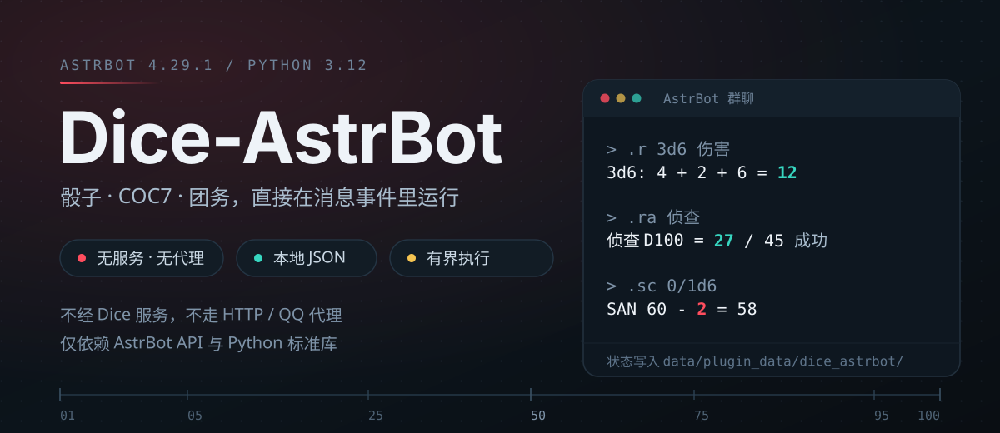

<p align="center">
  
</p>

<p align="center">
  
  
  
  
  
</p>

**Dice 的原生 AstrBot 实现。** 骰子、COC7 检定、角色卡与团务状态，全部在 AstrBot 的消息事件里直接处理：不启动 Dice 服务，不走 HTTP / QQ 代理，只依赖 AstrBot API 与 Python 标准库。目标运行环境为 AstrBot 4.29.1 / Python 3.12。

移植自 [Dice-Developer-Team/Dice](https://github.com/Dice-Developer-Team/Dice)（Dice! C++ 发行版，AGPL-3.0）：命令面与 COC7 行为对齐上游，宿主与依赖被替换为 AstrBot 原生实现，未移植项在下方逐条列出。

<p align="center">
  
</p>

## 三分钟上手

1. 把仓库里的 `dice_astrbot/` 目录复制到 AstrBot 的 `data/plugins/dice_astrbot`（也可以在 WebUI 插件页直接上传打包好的 zip）。
2. 在 WebUI 里重载该插件，或重启 AstrBot。
3. 在群里发一条 `.r 3d6`。

```text
> .r 3d6 伤害
3d6: 4 + 2 + 6 = 12

> .ra 侦查
侦查 D100 = 27 / 45  成功
```

插件数据保存在 `data/plugin_data/dice_astrbot/dice_state.json`。**首次使用前请备份旧状态文件**：插件不会自动扫描或导入旧数据，迁移只支持下文由所有者显式触发的白名单实验性子集。

> **兼容性**：入群欢迎语与退群/被踢提示依赖 OneBot V11（aiocqhttp）原始 notice 事件。AstrBot 4.29.1 的公共插件 API 没有跨适配器成员生命周期事件，其他适配器不支持这两项（命令本身仍可用）。

<p align="center">
  
</p>

## 能力与代表命令

所有命令默认以 `.` 为前缀，可在配置里替换。下表是入口；每个命令的完整语义、边界与安全限制见下方折叠的完整说明。

| 能力 | 代表命令 | 一句话说明 |
| --- | --- | --- |
| 骰子 | `.r` `.roll` `.rs` `.rh` | NdS 表达式、默认骰、K 取高、Fudge、B/P 奖励惩罚骰、表达式别名 |
| COC 检定 | `.ra` `.rc` `.sc` `.ti` `.li` `.en` | 0–7 房规、难度与倍率语法、1–10 次批量、具名角色卡检定 |
| 骰池 | `.w` `.ww` | D10 成功数池，目标默认 8，支持正/负池 |
| 角色卡 | `.coc7d` `.pc …` `.st …` | 生成/复制/重命名/导出，库存 32 张，活动卡按会话记录 |
| 团务 | `.game …` `.ob` `.ri` `.init` `.log` | 多存档、主持人/玩家/旁观者、跨聊天挂接、先攻与团务日志 |
| 牌堆 | `.draw` `.deck …` | 67 个上游公共牌堆 / 4,952 项，支持有界模板与静态权重 |
| 自定义回复 | `.reply …` | 精确/前缀/包含/安全正则子集、加权牌堆、概率与限额 |
| 群管理 | `.group …` `.ban` `.link` `.welcome` `.bot` | 群开关、盲骰、跨群文本链接、入群欢迎语 |
| 辅助 | `.jrrp` `.name` `.nnn` `.me` `.helpdoc` | 每日人品、随机姓名与昵称、角色扮演动作、自定义帮助页 |

## 为什么是"原生"而不是代理

- **没有中间件**：直接在 AstrBot 消息事件内完成解析与回复，不额外起进程、不建 HTTP 通道、不依赖 QQ 协议实现。
- **有界执行**：正则走自研 NFA 子集（不全用回溯引擎），牌堆模板与骰式别名通过有界解释器展开，表达式长度、骰数、递归深度都有硬上限。
- **数据本地**：状态只写插件自己的 JSON，不联网、不上传。
- **拒绝而非假装**：依赖 Dice 服务、C++ 模组宿主、驱动群管理接口的上游命令被显式拒绝，不会静默降级成别的行为。

<p align="center">
  
</p>

这不是完整的 C++ Dice 发行版。下面折叠的五份内容是完整参考：安装与配置、完整命令说明、团务日志与旧卡库迁移、与上游 Dice 的差异清单（逐条列出未移植项），以及开发与验证记录（含只做过临时 listener 冒烟、尚未跑过真实连接器 E2E 的部分）。

<details>
<summary>安装与配置（详解）</summary>

### 安装

将本仓库的 `dice_astrbot` 目录完整复制到 AstrBot 的 `data/plugins/dice_astrbot`，在 WebUI 重载或重启 AstrBot。插件数据自动保存在 `data/plugin_data/dice_astrbot/dice_state.json`。首次使用前备份旧状态文件；插件不会自动扫描/导入旧数据，仅支持下文所述由所有者显式触发的固定版 PlayerCards、UserConf 和 ChatConf 白名单实验性迁移；其他 C++ 二进制存档、未列出的 `.dat` 及 XML 格式仍未支持。

### 配置

AstrBot 插件配置项：

- `prefix`：AstrBot 配置默认 `.`。可配置 `prefixes` 数组启用多个前缀，设置后覆盖单个 `prefix`，较长前缀优先匹配；未提供任何配置时兼容 `.` 和 `!`。
- `default_die`：裸骰 `D` 的全局兜底面数，默认 100；用户可用 `.set [面数]` 设置个人默认值（1–9999），无参数设为 D100；有活动角色卡时 `.set` 改写卡片 `__DefaultDice`，并优先于个人值。
- `max_message_length`：忽略过长输入，默认 500。
- `max_response_length`：限制插件回复，默认 4000。
- `default_coc_rule`：默认 COC 房规，范围 0–7，默认 0（规则书）；群管理员可用 `.setcoc` 设置规则，活动团务中保存为团务覆盖，否则保存在当前群/私聊范围。
- `disable_jrrp`：全局禁用今日人品，默认 `false`；禁用后 `.jrrp` 在群聊与私聊均不可用。
- `disable_me`：全局禁用 `.me` 角色扮演动作及私聊指定群发送，默认 `false`。

</details>

<details>
<summary>完整命令说明</summary>

### 已实现命令

所有命令默认以 `.` 为前缀；配置后替换为自己的前缀。

- 骰子：`.r [次数#]表达式 [理由]` / `.roll`（次数 1–10，支持骰式计算；次数骰不消耗团务轮盘；批量主骰逐次使用团务轮盘）、`.rs` 短式（批量输出总数并列出 D100 极值）、`.rh/.rsh/.h/.hs` 隐藏掷骰，支持 NdS、默认骰（含卡片 `__DefaultDice`）、K 取高、Fudge、COC 奖励/惩罚骰 B/P、加减乘除及有限括号分组；`.r` 支持卡片 `__DefaultDiceExp` 默认公式和 `.st &名称:骰式` 保存的表达式别名（支持 `{属性}` / `&别名` 引用；每条最多 160 字符、引用深度 16、拒绝循环，不执行脚本）；活动 COC7 卡另提供 8 个动态属性、技能缺省值与 120 个骰式/武器公式别名；团务轮盘只影响骰数 <10 的普通骰项及 B/P 基础 D100，Fudge、K 取高、骰数 ≥10 与 B/P 额外十位骰走系统 RNG；表达式长度、骰数和数值有边界限制。
- COC：`.ra [次数#]技能或数值`、`.rc [次数#]技能或数值`、`.sc 成功损失/失败损失`、`.ti`（临时疯狂，1D10 症状/轮数，结果 9–10 追加 1D100 细节）/`.li`（长期疯狂，1D10 症状/小时，9–10 追加细节）、`.en 技能 [当前值] [失败变化/成功变化]`、`.w/.ww [次数#]骰池表达式 [理由]`（D10 成功数池，目标默认 8，D5–D11 设置追加骰阈值，支持正/负池和额外成功值（负池总分按符号计算，修正上游组合显示符号与 intTotal 不一致）；读取活动卡数值属性、安全展开的表达式别名及 `__DPTarget`；`.ww` 显示逐轮详情，`.wh/.wwh` 群内隐藏并尝试私信；次数上限 10、初始骰池上限 100、单命令累计递归掷骰上限 10,000；卡片表达式最终仍须符合本地骰池语法）、`.coc/.coc7/.cocs/.coc7s [组数 1–10]；.coc6/.coc6s [组数 1–10]`；检定支持 1–10 次批量投骰（如 `.ra 3#困难侦查`），支持 B/P 奖励/惩罚骰（如 `.ra B2困难侦查`、`.rc P1聆听`）；支持按单次检定选择具名角色卡（`.ra 阿丽:侦查` / `.ra 阿丽的侦查`，不切换活动卡）；隐藏检定支持 `.rah 技能` / `.rch 技能`、`.ra_技能` / `.rc_技能`、`.raB_技能` / `.raP_技能` / `.rcB_技能` / `.rcP_技能` 等写法，群聊只回不含点数的提示，并尝试私发给掷骰者及活动团务主持/旁观者；私聊失败不回退到群消息。群管理员可用 `.group blind on/off` 开启群级盲骰：仍私发给主持人/旁观者，但不私发给掷骰者；私聊不提供该开关。直发依赖 connector 支持。上游 0–7 房规、标准技能默认值/别名，以及自动成功/简单/困难/极难/极限、*倍率、重复±修正、/除数及指定数值（如 `.ra 困难侦查*2+5/2`）；无活动角色卡时可直接用标准技能名检定，有活动卡时优先使用卡内值。`.ra/.rc` 在活动团务中优先用团务房规，否则用群/私聊设置；按上游语义，`.sc` 用群/私聊房规，不取团务覆盖。
- 角色卡：`.coc7d/.coc6d [名称]`生成并激活本地卡，回执保留 Dice 上游逐项属性/派生值报告，超响应上限时改用含全部值的紧凑摘要（不截断）；`.pc create/list/grp/stat/type [COC7]/temp/use 名称/tag [名称]/show/set/build/redo [pc|bg|pc:bg][:卡名]/nn 新名称/cpy 目标[=来源]/tojson [卡名]/delete/clr`、`.st 属性 数值|&表达式:骰式|del 属性|clr|show [卡名:属性]`。`.pc tag 名称`选择角色卡，不带名称时仅重置本群/私聊会话的活动卡选择；`.pc nn 新名称`重命名当前活动卡并同步该用户所有群/私聊选择，名称限制 1–40 字且不能含 `:`/`=`；`.pc cpy 目标[=来源]`按大小写不敏感名称复制/覆盖角色卡，省略来源时复制当前卡，且不改变活动卡选择；`.pc tojson [卡名]`只导出本人当前会话活动卡或指定卡的属性 JSON（含 `__Name`/`__Type` 元数据，不执行公式/脚本；最多 min(4000,max_response_length) 字符，损坏/超限拒绝而不截断，不支持导出他人卡）；`.pc grp`只读列出默认卡和当前平台/bot已记录的群卡映射，跳过私聊映射与其他bot范围，输出受单条回复上限约束；`.pc stat`只读当前卡与个人默认骰匹配的掷骰统计及全部检定统计：仅计与默认面数完全匹配的单骰 `.r`、成长 `.en` 的 D100、普通（非 B/P）`.ra/.rc` 与 `.sc`；统计保存于卡片本地 JSON，显示均值/公平骰期望、离散度/百分位和检定成功率；损坏统计拒绝覆盖。`.pc type`可查询或切换到唯一支持的安全内置类型 COC7；`.pc temp`只显示其静态字段摘要，不加载任意 XML/JS。`.pc clr`清空本人角色卡及活动指针，保留昵称等其他玩家数据；`.st clr`清空当前卡属性，`.st del 属性`删除一项，`.st show`读取当前卡属性，`.st show 卡名:属性`或`卡名的属性`只读指定角色卡而不切换活动卡。角色卡库存按平台用户/bot 共享，最多 32 张（修正上游边界条件会放过第 33 张的问题）；当前活动卡按群或私聊会话分别记录，升级前的全局活动卡仅作回退，不复制到每群映射。技能可通过角色卡自定义属性后使用 `.ra 技能名` 检定，也可用 `.ra/.rc 卡名:技能` 或 `.ra/.rc 卡名的技能` 指定本人角色卡（最长卡名优先，不切换活动卡；不存在的卡会拒绝）；显式重名创建会拒绝并保留旧卡，未指定生成名时自动避让冲突。
- 团务：`.game new/start [团名]`、`.game open 桌号`、`.game list/status/state`、`.game master/set/call/join/leave/exit/kick/rou`、`.game close/stop/over`、`.ob join/on/off/list/clr/exit`（旁观者）、`.ri [修正/骰子表达式] [次数#名称]`、`.init add/remove/clear/show`。`.game set` 管理桌属性，`true/false/null` 与 JSON 数值/字符串/数组/对象按类型保存，其他文本原样保留，空值清除属性；`.game call` 原生 @ 玩家，`.game kick` 可按平台用户 ID 移出玩家或旁观者，`.game rou` 管理轮盘骰袋；`.ob join` 可在开团前加入旁观名单，`on/off` 仅群管理员可改。`.ri` 先攻次数写在 `#` 前，范围 1–10；不写骰式时用 D20；未给名称时优先使用活动的非通用角色卡名，其次本群昵称，再退回用户 ID。每个群允许多个命名团务存档，但同时仅一桌活动；new/start 自动存档当前桌并切换，新桌号会在回复中返回；本地团务的 close/stop 保存并脱离，共享团务的 close/stop 仅脱离当前聊天；open 可按桌号重开，over 永久删除当前桌。群聊中的 new/start 仅群管理员可执行；私聊按发送者隔离，私聊用户可开启自己的团务。open 可在同一 platform/bot 范围内按桌号挂接其他聊天的活动团务或存档：群聊仅该桌主持人可挂接，私聊仅该桌主持人或参与者可挂接，群管理员身份不单独授权跨聊天 open；无法取得有效 platform/bot 身份时拒绝跨聊天查找。共享挂接下 close/stop 只从当前聊天脱离，不结束其他聊天仍挂接的团务；over 永久删除共享团务及所有聊天引用。未共享的本地归档仍可在原聊天按桌号重开。私聊状态的用户数据仍按发送者隔离。hostless 团务可由群管理员（群聊）或私聊发送者初始化主持人。私聊状态无法像上游一样由多个私聊用户共享同一桌。
- 辅助：`.dnd [组数 1-10]`（每组 6 个 4d6 去最低、降序）、`.d20 [修正] [DC]`、`.name [类型] [次数 1-10]` 批量生成；`.nnn [类型]` 随机生成并设置本会话昵称；`.user state` 只读查看本人本插件卡数/昵称数/默认骰（Dice trust/注册时间不可用）；私聊 `.user tojson` 可导出本人本地 JSON（≤4000 字符，拒绝目标 ID/跨用户导出）；同群自定义牌堆 `随机姓名_类型` 优先，否则使用对应内置模板或 `随机姓名`；`.nn 昵称|del|clr`（最多 50 个 UTF-8 字节；del 删除本群昵称，clr 清空全部昵称）、`.jrrp [on/off]`（群管理员开关）、`.me 动作|on/off/status`（群管理员开关；私聊 `.me 群号 动作` 按当前 AstrBot 平台实例发送（UMO 不含 self_id；单实例多 bot 无法指定账号））、`.link with|to|from 群号|state|list|start|close`（群管理员管理）、`.legacy scope/preview/import`（仅配置所有者私聊可用；详见迁移说明）、`.set [面数]`（个人裸骰默认值；活动卡时设置卡片默认骰）、`.setcoc 0-7|show|clr`（COC 数字房规）、`.rule set 规则名|.rule set（重置）|.rule show|.rule s 关键词`（本地记录规则名；未导入手册，不代理搜索）、`.group card 用户ID 角色卡名`（普通成员可切换本人，群管理员可切换他人；仅查同平台/bot 已有卡片）；`.group status/state/on/off/+选项|-选项`（当前群只读/设置；写操作需群管理员，支持六项本地配置；多项可连续符号或空格分隔）、`.group blind status/on/off`、`.group all +选项|-选项`（选项：停用指令|禁用回复|禁用jrrp|禁用draw|禁用me|禁用help；全局管理员私聊；仅作用于本地已记录群）、`.bot on/off/status [当前 bot 数字 ID（全号或末四位）]`（仅群聊；开关需群管理员；可选目标必须匹配当前 AstrBot bot ID）、`.ban add/remove 用户ID`、`.re <正则模式> <选项1|选项2>（无选项删除 Regex 规则）、.reply set/re/regex/list/show/get/add/prefix/search/deck/limit/del(delete)/on/off`（群管理员；add 精确匹配，prefix/search 为前缀/包含匹配；deck 支持静态 标签::整数权重::文本（每项 1-1000、总权重≤10000）；`.reply limit [模式] 触发词 | prob:50;user_id:123,456;grp_id:!789;cd:30&@echo=冷却中;today:5&@echo=日额已满` 设置 prob 0–100（0/100 不筛选）、用户/群 ID 允许或排除列表，以及默认本会话或 `cd:@user=秒`/`today:@user=次数`/`cd:@global=秒`/`today:@global=次数` 范围的冷却/日额（`cd` 0–86400，`today` 0–10000）；用户范围按平台+bot 身份隔离，全局范围覆盖本插件存储内所有会话；ID 按 AstrBot 原始事件值精确比较，名单最多 32 个 ID、单 ID ≤128 字符、规格 ≤512 字符。日计数按 Asia/Shanghai 日界持久化，冷却仅当前插件进程有效；同步锁仅在本插件进程内生效：`lock` 是全局默认标题键，`lock:键[@chat|@user|@global]&...` 未标范围默认为 chat、最多 4 把，覆盖本插件该次回复输出，不跨进程/其他插件；不支持锁提示；普通 Text 回复仅对完全匹配的 `{uid}`/`{gid}`/`{nick}`/`{pc}`/`{fromUser}`/`{fromQQ}`/`{fromGroup}`/`{fromMsg}` 作一次安全替换（最多 100 处，未知引用或带冒号指令保留原文；以反斜杠转义的左花括号（如 `\{uid}`）按字面显示并移除转义符；Prefix 模式另提供 `{suffix}`（匹配前缀后的原消息，最多 500 字）；nick 按本会话昵称→AstrBot发送者名→用户ID回退；pc 输出当前会话激活卡名（默认“角色卡”或无卡时回退 nick，仅名称），私聊 gid=0；fromUser/fromGroup 分别是当前原始用户/群 ID；fromQQ 是 fromUser 的上游兼容别名，私聊 fromGroup 为空；fromMsg 是当前原始消息，最多 500 字；`{gender}` 仅读取本地导入的 gender 文本（≤128 字），不查询平台资料）；Regex Text 支持 `$&` 全匹配、`$$` 字面美元；全串匹配下前/后缀替换为空，支持 $1–$99 编号捕获组（未参与组为空；越界组号保留原文）；Deck 占位符、嵌套/高级变量、超出本地安全子集的正则语法和脚本不执行；开关仅影响自定义回复）、`.ak new 标题[+选项|选项] / add / del 序号 / get / show / clr`（群/私聊各自保存单个选项堆；支持 `#/+/-/=` 快捷式；抽中后清空选项；最多 500 项、单项 120 字、标题 40 字）、`.deck list/create/new/set/show/reset/del/clr`（无活动团务时按本群保存；活动团务时牌堆独立随 close/open 存档）；团务牌堆写操作需群管理员或本桌主持人。团务 new/create 最多256项，支持固定整数权重 `标签::N::牌面`（N=1–999，展开≤1024）；活动团务 `.deck set` 可复制静态公共牌堆、白名单内置模板或有限 range（模板牌面抽取时经有界解释器展开）；无活动团务时群级 `.deck set` 仅复制静态牌堆或范围；群成员名单来源仍拒绝。`.draw [h|_]牌堆名 [次数1–10]` 优先团务牌堆，其次本群牌堆，最后公共牌堆；自定义牌堆无放回，隐藏抽牌仅尝试私信且不记录隐藏输入，公共牌堆不消耗。67 个内置公共牌堆含21个有界模板（深度≤16、子抽取≤128、骰式≤64、输出≤4096）、`.log、`.help [on/off]`（群聊仅管理员可开关；关闭只隐藏帮助，私聊只查看）、`.version`。需要管理权限的操作使用 AstrBot 当前事件的管理员状态；私聊状态按发送者隔离，群状态与玩家数据按平台连接器及 bot 身份隔离。管理员私聊可用 `.system state/on/off/clock` 管理本插件静默及每日 on/off（宿主本地时区；最多 100 个时点，仅支持每分钟一个动作；定时执行器随 AstrBot 插件生命周期启停）；`.admin on/off` 是同一全局静默开关的上游别名；`.admin censor +Warning:词1,词2 / -词1,词2`（仅全局管理员私聊；等级 Ignore/Notice/Caution/Warning/Danger/Critical；每次最多 8 词、每 bot 256 词；忽略空白及 ASCII 标点，仅过滤带前缀的 Dice 命令（admin/system/bot 控制不拦截），不处理普通聊天/自定义回复且无内置词库；损坏数据 fail-closed，需手动修复）；`.admin notice [this] [0–63|off|+N -N]（订阅级别为 0–63 位掩码，按位匹配）` 仅管理当前会话：群内需管理员，私聊需全局管理员；`.admin notice list` 群内仅列当前群，私聊全局管理员可列本插件全部已存范围（最多 100 条、最多显示 24 条）；订阅记录按平台/bot身份隔离；UMO 不含 self_id，同一平台多 bot 无法保证指定账号发送；最多 100 个订阅、每次最多 50 个收件人，仅订阅变更/敏感词规则变更(level 1)、`.system on/off`(level 3)及 clock 成功增删(level 2)触发本地纯文本通知，其他上游通知来源未实现。
- `.reply set` 仅实现上游安全子集：Tab 分隔 `Title:`/`Type:`/`Limit:`/`Match|Prefix|Search|Regex:`/`Text:` 或 `Deck:` 字段；Title 可独立命名（1–128字）；省略或为空时默认为最后一个匹配字段原文；Match/Prefix/Search 各支持以 | 指定最多32个别名，Regex 每字段一个；可配置多个匹配模式；同 Title 的别名共享限制并可按标题管理；Type 可省略或为 Reply；Text≤500 字，Deck 为 2–32 项静态选项；Regex 使用 case-insensitive full-match NFA 安全子集（pattern≤128 字、输入≤400 字、≤256 状态、≤100,000 步/规则、每会话≤20 条），支持常见分组/或/字符类/量词/锚点；Limit 复用本地安全 parser（含 prob/ID/cd/today 与最多 4 把 chat/user/global 同步锁；锁仅限本插件进程）；管理权限采用 AstrBot 管理员状态，不等同上游 trusted≥4。另兼容上游直达入口 `.reply re <pattern> <文本>`（省略文本删除该 Regex 规则；pattern 按首个空格截取），仍受同一 NFA 安全边界限制。lookaround、反向引用、词边界等 Regex 语法，以及 Lua/JS/Python 脚本及 Order/Both/Game 等非 Reply 类型均拒绝。
- 跨群文本链接：`.link with/to/from 群号` 建立双向/单向链接，`.link state/list/start/close` 查询、恢复、暂停；群链接状态按 platform_id 与 bot self_id 隔离，发送按 UMO 的 platform_id 路由；AstrBot 4.29.1 UMO 格式为 platform_name:message_type:session_id，不含 self_id，若单个 adapter 实例复用多个 bot 账号则无法保证具体账号，因此建议一个 bot 一个 platform instance，链接状态保存在本地。链接会立即转发群内文本及本插件的可见命令回复（隐藏掷骰的输入不转发）；不转发图片等附件或其他插件的输出。启用前须确认目标群知情同意；目标群身份/同意不会被自动验证，适配器接受发送不代表最终送达。
- 自定义帮助页：`.helpdoc key` 查询，`.helpdoc key 正文` 设置，`.helpdoc key reset` 删除。仅 AstrBot 平台全局管理员可在私聊管理；按 platform/bot 范围隔离，不执行上游 formatter/脚本指令；每范围最多 100 页、每页≤2000 字、总正文≤32000 字，损坏数据拒绝写入。AstrBot 4.29.1 `Main(Star)` 临时 listener 冒烟标记：`REAL_ASTRBOT_HELPDOC_LISTENER_OK`、`REAL_ASTRBOT_HELPDOC_DATA_GUARDS_OK`。源/目标群管理员均可从各自群暂停链接。

</details>

<details>
<summary>团务日志与旧卡库迁移</summary>

### 团务日志（本地子集）

支持 `.log new [名称]`、`on [名称]`、`off`、`end`、`status`、`show [1–12]`、`show archive [1–6]`、`archives`；不带子命令的 `.log` 仍是原有的最近骰子/检定记录视图；`.game status` 展示当前有效数值房规与已设置的团务规则名、主持人/玩家/旁观者名册（每类最多显示 10 项并优先使用本会话昵称）、通过结构校验的轮盘骰面和活跃日志名；名单字段和名称均有输出上限。日志只记录当前团务的主持人/参与者消息和插件可见回复；每份最多 200 条、每条最多 500 字，保留裁剪计数。`.game over` 仍会删除团务桌状态，但会额外保存最近 3 份日志快照；原团务主持人或群管理员可读，损坏的日志归档会阻止删除以免丢数据。控制/查看权限比上游命令分支更严格，限定为当前团务主持人或群管理员。隐藏检定的入站命令可能会记录，但私信中的结果不保存，群内只保存公开提示；如不希望记录隐藏检定输入，请不要在该聊天开启团务日志。数据写入插件 JSON，`.log end` 不会上传文件，也不运行上游 LogEnd/uplog 钩子；日志生命周期与文件名/路径行为并非完全上游兼容。实际 AstrBot 4.29.1 Main(Star) 临时数据 listener 冒烟标记为 `REAL_ASTRBOT_SESSION_LOG_OVER_OK`，覆盖参与者记录、隐藏结果隐私、暂停/恢复、`.game over` 归档、原主持人/群管理员权限、未授权拒绝和损坏归档 fail-closed；事件为 duck-typed，未测真实适配器。

### 旧卡库迁移（实验性）

支持固定版 Dice x64 的 `PlayerCards.RDconf`、`PlayerCards.RDconf.bak` 与 `PlayerCards.bak`；使用 `.legacy preview [rdconf|rdconf.bak|bak]` 选择来源，不带格式时默认为 `rdconf`；暂存位置为插件数据目录下的 `imports/`。先将原始数字用户 ID 填入 `legacy_import_owner_id`，保存并加载插件；由该用户在私聊执行 `.legacy scope`，将返回的 JSON 范围填入 `legacy_import_owner_scope`。范围留空时预览/导入会在读取文件前拒绝；填入后仅该用户及精确 platform/bot 身份可执行 `.legacy preview/import`。迁移只新增玩家记录：任一目标用户已存在就整批拒绝，不覆盖本地玩家；单个旧用户最多保留上游历史边界允许的 33 张卡，超限整批拒绝；本地新建仍限制 32 张；原始文件只读不改，属性函数/非数值/内部/公式属性、空名卡记录及指向缺失卡片的群映射会被跳过并计数；Lock/DiceExp/Info/Note 区段不迁移但会在预览和回执中计数；重复卡片 ID 或重复群映射 ID 会拒绝导入。

另支持 `UserConf.dat`、`UserConf.dat.bak`、`UserConf.bak`、`UserConf.RDconf`，分别以 `dat`、`dat.bak`、`bak`、`rdconf` 选择，并要求预览/导入使用同一格式；迁移全局/当前 bot 范围内群昵称、个人默认骰（1–9999）、个人默认规则名（最多 128 字）、上游 `gender` 字段文本（最多 128 字，仅导入本地显式值、不查询平台资料）及个人私聊 COC 房规（0–7；写入对应 platform/bot 私聊组配置）。只读取这些白名单键，不迁移 Dice trust、其他配置、时间戳或内部 ID。预览绑定文件 SHA-256、格式和 platform/bot 身份；存在不同昵称、默认骰、规则名、gender 或私聊房规时整批拒绝，已有角色卡及其他玩家/群字段保留。所有格式均无版本头，目前仅用合成源格式样本验证、没有真实档案验证，属实验性；请先备份源文件和 AstrBot 插件数据。`ChatConf.dat`、`ChatConf.dat.bak`、`ChatConf.bak` 与 `ChatConf.RDconf` 可通过 `.legacy groups-preview dat|dat.bak|bak|rdconf` / `.legacy groups-import 同源格式` 仅迁移六项群开关、`Rh盲骰`（隐藏骰不向发送者重复回显）、`rc房规` 0–7 与 `入群欢迎` 群内纯文本（≤500 字，不执行模板且不触发入群通知）；仅当前配置所有者私聊可用，绑定 SHA-256 与 platform/bot 身份，只有缺省或相同值可合并，冲突整批拒绝；群开关遵循上游 AttrVar 真值：布尔 false/null 不视为已设置，整数 0 等其他非 null 值视为已设置。群名、按频道 ID 索引的 Chat::ChConf、信任、卡组、日志及其他字段不迁移；ChatConf 同样仅用合成样本验证，真实档案未验证。旧 XML、上述 ChatConf 文件名以外的备份及其他版本仍不支持。

</details>

<details>
<summary>与上游 Dice 的差异（完整清单）</summary>

### 与上游的差异（当前明确未移植）

这不是完整的 C++ Dice 发行版；以下部分依赖 QQ 驱动、服务器、原生存档格式或上游脚本生态，当前没有实现：

- QQAPI 生命周期与驱动/连接器管理命令（`.groups list/clr`、`.authorize`、`.dismiss`、`.4kick`、`.chan`）在插件中均被识别并显式拒绝、不代理，分别依赖驱动群缓存/清理策略、群许可证/GroupAuthorize 或退群/踢人/频道 API；`.welcome show/set/clr` 和直接 `.welcome <文本>` 仅由群管理员管理当前群纯文本欢迎语（最长 500 字、不执行模板）；OneBot V11（aiocqhttp）适配器对通过审核/邀请入群自动发送本群欢迎语，并在群内提示成员退群/被踢；其他适配器不支持成员生命周期检测；`.group state` 仅显示六项本地配置；`.group info` 仅只读显示当前消息事件携带的群/频道名、ID及成员数；字段可能缺失，不调用远端接口且不支持查询其他群；`.group tojson` 仅群管理员可导出当前群的安全本地 JSON 子集（六项本地开关、群级规则覆盖和盲骰开关；不含群/成员 ID、会话、角色卡、自定义回复、牌堆或日志，不可指定其他群；不是上游完整 Chat JSON）；`.group survey/diver/diver4kick/pause/restart/ban/kick/title` 因依赖驱动群成员/禁言/踢人/头衔接口或 Dice trust 而显式拒绝，不会操作平台；普通成员可用 `.group card 用户ID 角色卡名` 切换本人卡，群管理员可切换他人卡（只查同平台/bot 下已有用户数据，不创建用户记录；本地仅改活动卡指针、不操作平台；无法验证目标是否为群成员、Dice trust≥4 或骰娘自身是否为群管理员，故不等同上游权限模型）；`.group +选项|-选项` 由群管理员设置同一六项并支持原子多项更新；`.group all` 已实现受限本地子集：仅 AstrBot 平台全局管理员私聊可批量设置“停用指令/禁用回复/禁用jrrp/禁用draw/禁用me/禁用help”；仅遍历本插件存储中已记录的非私聊群（覆盖本插件已保存的 platform/bot 身份），不枚举平台未知群；上游 Dice trust≥5 权限层级、未映射选项（如禁用ob及许可/信任/清理配置）和完整 ChatList 语义未移植；全局 `.master` 认主/信任等级管理（上游依赖启动口令及 trusted>4/现任 master；不等同 `.game master`；本地已注册并显式拒绝，不记录或转发启动口令）、`.user trust/diss/kill/clr` 依赖 Dice 用户注册表、信任等级、黑名单与跨记录清理，未移植；跨用户/管理员 `.user tojson` 不可复刻（本地仅有私聊本人 JSON 导出）；上游 `.authorize` 群许可申请/授予（依赖许可状态与 GroupAuthorize hook；本插件不执行许可门控）；`.admin only/public` 私用/公用模式还依赖信任等级自动授权及未许可群自动退群，AstrBot 无对应群生命周期驱动、驱动退群命令 `.dismiss`、禁言踢人命令 `.4kick`，以及跨连接器/多媒体消息转发及各驱动能力回退。本地 group-all 子集实际 AstrBot 4.29.1 Main(Star) 临时 listener 标记 REAL_ASTRBOT_GROUP_ALL_LISTENER_OK，覆盖全局管理员/群管理员边界、六项开关、私聊排除、未知项拒写与损坏状态事务回滚。
- Dice Web 管理服务器、远程管理与认证；上游 `.cloud update/black` 依赖 Dice 云服务/授权，本地识别后显式拒绝且不联网；上游任意目标 `.send <目标>` 仍依赖 Dice trust 与目标会话解析，本地拒绝且不发送；另支持受限 `.send notice0+2 <单行文本>` 子集：仅私聊平台全局管理员可按位发送 0–5 级、≤500 字且受配置响应长度上限约束的纯文本至本插件同 platform/bot 范围的匹配订阅者；不等同上游主控/notice 队列，实际送达由适配器决定；完整内容审查（本地仅实现有界 `.admin censor` 字面规则子集；无内置词库、WordCensored hook、普通聊天/自定义回复过滤）、完整插件管理后台；`.admin state/frq/dicelist` 依赖 Dice 主控 trust、连接器资源、滚动频率队列/反垃圾监控及多骰实例注册表，本插件没有等价数据源，明确未移植。
- 上游 `.mod` 模组安装/更新/重载/删除依赖 C++ 扩展宿主；`.str` 查询/修改/重置全局 Formatter 字符串表依赖 Dice trust 与格式器，本地均明确拒绝且不代理；Lua/JS/Python 脚本生命周期、模组钩子/定时器/自定义命令亦未移植。
- Dice 上游 .welcome 成员加入通知尚未完整移植：本地仅通过 OneBot V11（aiocqhttp）原始 notice 在入群时发送群管理员配置的纯文本欢迎语，并在群内提示成员主动退群/被踢；AstrBot 4.29.1 公共插件 API 未暴露跨适配器成员生命周期事件，其他适配器不支持；.warning JSON 队列/BlackInfoWarned hook 与全局黑名单校验（依赖上游审核扩展；本地命令明确拒绝且不转发，不伪装为普通文本警告）、Dice ConsoleTimer 的备份/过期清理及扩展定时任务（本插件仅实现 `.system clock` 每日 on/off 子集，使用宿主本地时区）、除受限本地子集外的 `.admin notice` 通知功能（当前仅支持当前会话 level 0–63 订阅及订阅变更/敏感词规则变更(level 1)、插件静默开关(level 3)、clock 成功增删(level 2)通知；另有受限 `.send notice` 子集（私聊平台全局管理员；等级 0–5；单行≤500字且受响应上限约束；仅投同 platform/bot 匹配订阅，实际送达由适配器决定）；上游其他通知事件、任意目标管理与完整消息队列未移植（本地 list 仅群管理员查看当前群、私聊全局管理员查看本插件全部已存范围））、超出前述安全字段子集的 UserConf/ChatConf 完整迁移、旧 XML/其他版本数据迁移、完整 COC XML 模板、用户自定义模板公式/JS 触发器（`.pc type/temp` 仅有 COC7 内置类型与静态字段摘要；COC7 模板的 8 个动态属性、技能默认值及 120 项骰式/武器公式已移植；内置 COC7 `pc` 和 `bg` 预设可用：pc 补齐九项基础属性；bg 按 7D6+8 生成年龄，并按上游缺省值 0 填入八个背景占位字段；build 仅补缺项，redo 重建所选预设，支持 pc:bg 组合；任意自定义模板 JS 不执行；用户自定义安全骰式与 `.r` 别名、`.ti/.li` 症状和细节表已移植）、Dice 的 Rh盲骰配置入口与 canRoomHost 授权语义（本地提供群管理员控制的 `.group blind status|on|off`，实现掷骰者私发抑制结果，但不是上游相同的配置入口）、以及完整 DND/其他规则集（标准技能默认值/别名、1–10 次批量检定与检定难度、倍率、修正、除数语法已移植）。67 个上游公共牌堆已打包：46 个静态牌堆共 4,746 条目，另 21 个内置模板通过有界解释器支持已知牌堆引用、整数权重与骰式；每次展开深度≤16、子抽取≤128、骰式≤64、输出≤4096 字符，不执行用户模板/脚本，无法求值的技能括号按上游保留；活动团务 `.deck` 牌堆随 session 持久化并由 close/open 存档恢复；支持固定整数及方括号安全骰式权重（建牌时求值展开，原始项≤256、骰式≤160字符、结果 1–999、展开≤1024张、累计随机抽取≤100000；不执行模板引用）；团务牌面抽取时也通过有界解释器展开白名单公共牌堆引用及方括号骰式；活动团务 set 支持静态牌堆、白名单内置模板及范围（range 省略终点默认为 0、步长默认为 1），无活动团务时群级 set 仅支持静态牌堆/范围；群成员列表来源仍未移植；`.draw h`/`_` 的隐藏结果仅私信且隐藏输入不写团务日志/链接；公共 `.draw` 从公共牌堆抽取后不消耗；模板子牌堆状态仅在单次抽取/命令内临时共享，不写入会话存档；`.name`/`.nnn` 优先同群自定义 `随机姓名_类型` 牌堆，回退对应内置模板或 `随机姓名`，`.nnn` 设置本会话昵称；上游规则手册查询依赖远程 HTTP POST，本地 `.rule set` 仅保存规则名，`.rule s` 不联网且提示未导入手册。角色卡库存按用户共享，活动卡选择按群记录；PlayerCards.RDconf 系列文件仅提供上一节的实验性白名单导入，其他二进制存档尚未支持。
- `.game master/set/call/kick/rou` 与 `.ob` 已实现本地核心流程，但 AstrBot 事件 API 未提供上游 `canRoomHost` 的 trusted 等级、邀请者等信息，权限判断因此采用可验证的群管理员/主持人/私聊边界；`.game call` 使用 AstrBot 原生 @ 组件并从平台 scoped 身份还原用户 ID。上游命令别名、复杂房间策略、频道事件与队列语义仍未完整移植；本地支持同一 platform/bot 范围内由主持人或私聊参与者按权限跨群/私聊挂接，其他 bot/platform 严格隔离。`.me` 私聊指定群发送由当前 AstrBot 平台实例/bot 限定；上游 trusted 等级、邀请者权限与跨驱动发送能力未移植，发送是否可达仍由适配器决定。本地还支持上游 `.reply set` 的受限兼容子集：Tab 字段、Type:Reply、Title 可独立命名；Match/Prefix/Search 可使用 | 定义多个别名，并可同时配置多模式；Regex 每字段一个；Text/静态 Deck；同一 Title 的别名共享限制且可按标题/别名查询、更新和删除；Regex 仅执行有界 NFA 子集（pattern≤128 字、输入≤400 字、≤256 状态、≤100,000 步/规则、每会话≤20 条），不使用 Python 回溯引擎；lookaround、反向引用、词边界等语法不支持；Lua/JS/Python 脚本及 Order/Both/Game 等非 Reply 类型均拒绝。自定义回复另支持精确/前缀/包含文本匹配、静态 literal Deck（标签::整数权重::文本）及 .reply limit 的概率/用户 ID/群 ID 条件（ID 按 AstrBot 原始事件值精确比较；未命中时继续检查次级规则）；Deck 为 2–32 项、权重 1–1000/项且总权重≤10000，文本≤500 字/项、总长≤4096 字；支持 chat/@user/@global 范围 cd/today 限额及每类 ≤400 字纯文本 &@echo 提示（不展开变量）；限额拦截后继续检查后续匹配并最多发送 3 条不同提示，再附后续命中回复；仅支持本插件进程内 chat/user/global 互斥锁（最多 4 把，不跨进程且无锁提示）；DiceMaid、复杂变量/格式指令（仅 Text 的 `{uid}`/`{gid}`/`{nick}`/`{fromUser}`/`{fromQQ}`/`{fromGroup}`/`{fromMsg}`/`{gender}`/`{pc}` 作有界替换（最多 100 处）；未知引用与带冒号指令保留原文；Prefix 另支持 `{suffix}`（匹配前缀后的原消息，最多 500 字）；Regex 仅支持有界 NFA 与 full-match 替换（含 `$1–$99` 捕获组引用））、完整 ECMAScript/std::wregex（本地仅有界 NFA 子集）、骰式权重表达式与 Lua/JS/Python 回调仍未移植且不执行；本地 JSON 只保存本插件生成的数据。

这些差异不得视为已由代理或上游二进制补齐。

</details>

<details>
<summary>开发与验证记录</summary>

### 开发验证

在仓库根目录运行：

```sh
python -m unittest discover -s tests -v
python -m compileall -q dice_astrbot
```

另以真实 AstrBot 4.29.1 Main(Star) listener、duck-typed 事件及临时数据验证 `.group state`、当前群六项多项开关、群管理员/私聊门禁、连续符号/空格分隔多项设置、.group all 复用映射、无操作不创建空状态、停用后 state/on 恢复、损坏布尔值 fail-closed 且保留无关损坏字段，标记 `REAL_ASTRBOT_GROUP_OPTIONS_OK`、`REAL_ASTRBOT_GROUP_MULTI_SIGN_OK`；另以真实 AstrBot Main(Star) 临时 listener 验证 `.group card` 本人/管理员授权、前导零数值归一、跨 bot 隔离、私聊/缺失身份拒绝和越权零写入，标记 `REAL_ASTRBOT_GROUP_CARD_AUTH_OK`；验证 info/tojson/survey/diver/diver4kick/pause/restart/ban/kick/title 十种驱动专属子命令明确拒绝且零状态写入、group state 只读及本人选卡仍可用，标记 `REAL_ASTRBOT_GROUP_DRIVER_COMMAND_GUARDS_OK`；均未测实际 connector 或完整 PluginManager 启动。另以真实 AstrBot 4.29.1 Main(Star) listener、临时数据验证 `.ra/.rc` 具名卡的冒号/“的”语法、最长重名优先、显式数值覆盖、活动卡回退及缺卡 fail-closed，标记 `REAL_ASTRBOT_COC_SELECTOR_PARITY_OK`；不代表实际 connector E2E。另以真实 AstrBot 4.29.1 Main(Star) 临时 listener 验证上游 `.mod/.str` 被消费并拒绝、无状态写入/日志/自定义回复/链接转发，标记 `REAL_ASTRBOT_UNSUPPORTED_ADMIN_COMMANDS_FAIL_CLOSED_OK`。另以真实 AstrBot 4.29.1 Main(Star) listener、duck-typed 事件和临时数据验证 `.authorize/.dismiss/.groups/.4kick/.chan/.welcome/.mod/.str` 共八类上游命令均被显式拒绝，且不触发精确自定义回复、不写状态/团务日志、不做 link relay，标记 `REAL_ASTRBOT_DRIVER_COMMANDS_FAIL_CLOSED_OK`；另以真实 AstrBot Main(Star) listener 验证 `.warning` 被显式拒绝且不触发自定义回复、状态写入、团务日志或 link relay，标记 `REAL_ASTRBOT_WARNING_FAIL_CLOSED_OK`；未测实际连接器 E2E 或完整 PluginManager 启动。

另以真实 AstrBot 4.29.1 Main(Star) listener、临时数据及 duck-typed 事件验证任意目标形式 `.send <目标>` 与 `.cloud update/black` 均被显式拒绝，且不触发自定义回复、不改变状态、不写团务日志、不执行 link relay，标记 `REAL_ASTRBOT_SEND_CLOUD_FAIL_CLOSED_OK`；该历史 listener 样例只覆盖任意目标发送，不覆盖新增的 `.send notice`。后者由测试桩覆盖，实际适配器送达未做 connector E2E。
另以真实 AstrBot 4.29.1 Main(Star) listener、duck-typed Group 元数据与临时数据验证 `.group info` 的同 ID 字段输出、控制字符清理、缺失/不匹配元数据降级、私聊/任意目标/异常 ID 拒绝，以及无本地状态写入，标记 `REAL_ASTRBOT_GROUP_INFO_METADATA_ONLY_OK`；不代表真实适配器字段覆盖、完整 PluginManager 启动或 connector E2E。

另以真实 AstrBot 4.29.1 Main(Star) listener、临时数据及 duck-typed 事件验证 `.user tojson` 私聊本人导出、群聊/目标 ID 拒绝、其他用户数据隔离、超长拒绝而不截断且不写数据/日志/relay，标记 `REAL_ASTRBOT_USER_TOJSON_SELF_ONLY_OK`；未测试实际连接器。另以真实 AstrBot 4.29.1 Main(Star) listener、临时数据和确定性 RNG 验证 `.game rou 3*2` 的 face-major 六项池、三次 `.r 3d3` 消耗、`.game rou hist/reset/clr` 与状态显示，标记 `REAL_ASTRBOT_ROULETTE_POOL_PARITY_OK`；另以真实 AstrBot 4.29.1 Main(Star) listener、duck-typed 事件及临时数据验证活动团务 `.deck new/set/show/reset/del/clr`、静态权重/range、`.draw` 1–10 批量无放回、群牌堆回退、close/open 存档恢复、权限/坏数据 fail-closed、隐藏 DM 与日志脱敏，标记 `REAL_ASTRBOT_SESSION_DECKS_OK`；未测完整 PluginManager 启动或实际连接器。

单元测试对 AstrBot API 使用轻量桩。另以真实 AstrBot 4.29.1 Main(Star) listener 和临时数据验证 `.bot` 群聊管理员开关、停用状态下 on/off、当前 bot 数字 ID 全号/末四位/前导零匹配、错目标及非法/超长 ID 零切换、私聊拒绝和 bot 状态隔离，标记 `REAL_ASTRBOT_BOT_TOGGLE_PARITY_OK`；未测实际连接器。另已在 AstrBot 4.29.1 的实际 Python 环境中导入真实 `Star` 并实例化 `Main(Star)`，用 duck-typed 测试事件派发 `.game`、`.setcoc`、`.rule`、`.ra/.rc`、`.ri`、`.li/.ti`、`.jrrp on/off`、`.name` 批量及 `.nn` 昵称、重复角色卡创建与默认 COC7D 命名、`.set` 用户默认骰/卡片 `__DefaultDice`、输入边界与连接器身份隔离，验证状态只写入临时目录；`.rule` 冒烟覆盖个人默认、团务覆盖、COC 房规隔离及远程搜索不联网，`.name` 冒烟验证 1–10 次、边界拒绝及类型牌堆抽取不消耗牌堆，`.jrrp` 冒烟验证群管理员开关、全局禁用和私聊隔离。另以 AstrBot 4.29.1 Main(Star) listener 冒烟覆盖 .link with/to/from、单/双向、管理员权限、隐藏检定输入不转发、暂停/恢复、群号规范化和 bot 状态隔离；Context.send_message 与隐藏 DM 使用可控桩，未测真实 connector。再以确定性骰面和真实 Main(Star) listener 冒烟覆盖 .w/.ww 成功池、D6 爆骰、数值属性别名、批量及隐藏 UMO 调用；模型用例覆盖正/负池与边界。隐藏发送用 StarTools.send_message mock 捕获调用，未通过真实 connector。另以实际 AstrBot listener 冒烟覆盖 67 个内置公共牌堆/4,952 项数据、21 个模板（嵌套姓名/塔罗/调查员信息、骰式与未解析技能文本）、确定性权重边界、`.draw` 公共牌堆不写状态、`.name` 批量共享子牌堆临时状态、`.nnn` 群昵称持久化/隔离及自定义同名优先；另覆盖自定义回复 exact/prefix/search、静态及加权 Deck、上游式 `.reply set` 安全子集（Match/Prefix/Search/Regex、Text/Deck、Limit、默认字段、拒绝项零写入）、prob 0/1/99/100、用户/群 ID allow/exclude、本会话与 @user/@global 的 cd/today、跨群用户共享/跨 bot 隔离、v1 状态加载、重启持久化、并发日额、查询回显、冷却/日额 @echo 提示、损坏限制状态 fail-closed、损坏回复容器保留且 set/add 拒绝写入、管理员权限与未命中回退；另用临时 AstrBot listener 验证 chat/user/global 锁范围、同范围串行与跨范围隔离、持锁至回复输出，以及 relay 异常/取消后的锁注册表清理；另以 `REAL_ASTRBOT_REPLY_SAFE_FORMATTER_OK` 验证 Text 回复 `{uid}/{gid}/{nick}` 替换、昵称优先级、私聊 gid=0、未知/冒号指令字面保留、嵌套/转义不展开、无递归替换及 100 处上限；仍使用 duck-typed 事件和临时数据。另以 `REAL_ASTRBOT_HELP_TOGGLE_OK` 验证 `.help on/off` 群级隔离、群管理员权限、私聊限制、状态重载、关闭后其他命令正常及损坏状态 fail-closed；事件不是实际适配器生成的 `AstrMessageEvent`，这也不是完整 PluginManager 启动或端到端连接器测试；Regex 接入后重新运行单元测试：38 项通过（0.249s），compileall 通过；另以真实 AstrBot 4.29.1 Main(Star) listener 和临时数据验证 Regex 分组/或/范围字符类/量词、大小写不敏感 full-match、exact→prefix→search→regex 优先级、含 alternation 的 Regex limit、show/list/delete、静态 Deck、危险语法零写入、管理员权限、每会话 20 条上限及 400/401 字输入边界，标记 REAL_ASTRBOT_SAFE_REGEX_LISTENER_OK；另以 REAL_ASTRBOT_REPLY_RE_SHORTCUT_OK；另以 REAL_ASTRBOT_TOP_LEVEL_RE_OK 验证 `.re` Regex Deck 设置/匹配/删除、权限与拒绝边界；当前 38 项回归通过、compileall 通过。 覆盖 `.reply re`/`.reply regex` 直达设置、匹配、无回复文本删除、危险语法零写入及 20 条上限；事件仍为 duck-typed，不是实际连接器端到端。另以 `REAL_ASTRBOT_ADMIN_NOTICE_OK` 通过实际 AstrBot 4.29.1 Main(Star) listener/临时数据验证当前会话订阅、位掩码 fanout、`.system on/off` 通知、发送者排除、平台/bot隔离、权限、持久化及损坏数据 fail-closed；另以 REAL_ASTRBOT_ADMIN_NOTICE_GUARDS_OK 覆盖 129 字平台 ID 拒绝、权限、bot 隔离、重载及损坏记录保留；REAL_ASTRBOT_NOTICE_LIST_FAIL_CLOSED_OK 确认全局 list 明确标记未移植、status 正常。另以 REAL_ASTRBOT_ADMIN_TOGGLE_ALIAS_OK 验证 `.admin off/on` 静默切换、全局管理员权限、静默期间恢复、群聊拒绝、level 3 通知及多余参数拒绝；`REAL_ASTRBOT_CLOCK_NOTICE_OK` 验证 clock 成功增删通知位掩码、静默边界与持久化；仍为 duck-typed 事件与 Context.send_message 桩，不是实际适配器端到端验证。另以 REAL_ASTRBOT_ADMIN_CENSOR_OK 验证 AstrBot 4.29.1 Main(Star) 临时状态下全局管理员私聊增删、六级行为、标点折叠、命令拦截、无效项拒绝及 bot 隔离；未覆盖普通聊天、自定义回复、内置词库或 WordCensored hook。部署前仍应在目标实例重载插件并做适配器冒烟验证。
另以真实 AstrBot 4.29.1 Main(Star) listener、临时数据及确定性检查验证 `.pc stat` 的默认模板骰不误计、显式单骰/批量统计资格、COC 检定与 SAN/成长统计、B/P 排除、显式卡选择、损坏统计不覆盖及统计写入故障不吞掉已完成的 `.r` 结果，标记 `REAL_ASTRBOT_CARD_STATISTICS_OK`；事件为 duck-typed，未测实际连接器或完整 PluginManager 启动。另以真实 AstrBot Main(Star) 临时 listener 验证 `.pc type/temp` COC7 查询/切换与静态字段摘要、拒绝其他类型/不支持模板、重复 `__Type` 键 fail-closed 且不覆盖，标记 `REAL_ASTRBOT_PC_TYPE_TEMP_OK`；另以真实 AstrBot Main(Star) 临时 listener 验证 `.master` 被注册后显式拒绝、启动口令不进入团务日志/跨群链接/自定义回复，状态不变，标记 `REAL_ASTRBOT_MASTER_SECRET_FAIL_CLOSED_OK`；另以真实 AstrBot 4.29.1 `Main(Star)` listener 与临时数据验证 `.pc tojson` 活动卡/大小写不敏感具名卡 JSON、私聊活动卡、缺失/损坏/超限拒绝、玩家数据不变，以及活动团务日志和跨群 relay 均不包含导出内容，标记 `REAL_ASTRBOT_PC_TOJSON_PRIVACY_OK`；未测真实连接器或完整 PluginManager 启动。

卡片 JSON 兼容：按上游 `AnysTable::to_json()`，对象中的 null/false 字段省略；数组中的 null/false 元素输出为 null。导出仍受节点、深度和字符预算约束。 实际 AstrBot listener 验证标记 `REAL_ASTRBOT_PC_TOJSON_UPSTREAM_VALUE_PARITY_OK`，并以 5000 项容器验证节点预算在扩展子节点前拒绝，标记 `REAL_ASTRBOT_PC_TOJSON_NODE_BUDGET_OK`。

</details>

## 许可证

本项目以 **GNU Affero General Public License v3.0（AGPL-3.0）** 发布，与上游 Dice! （[Dice-Developer-Team/Dice](https://github.com/Dice-Developer-Team/Dice)）保持一致，完整条款见 [LICENSE](LICENSE)。

Dice-AstrBot 是 Dice! 的 AstrBot 移植版本，不是上游官方发行物；未移植项与行为差异见上方折叠的《与上游 Dice 的差异（完整清单）》。二次分发与修改需同样以 AGPL-3.0 提供源码。
